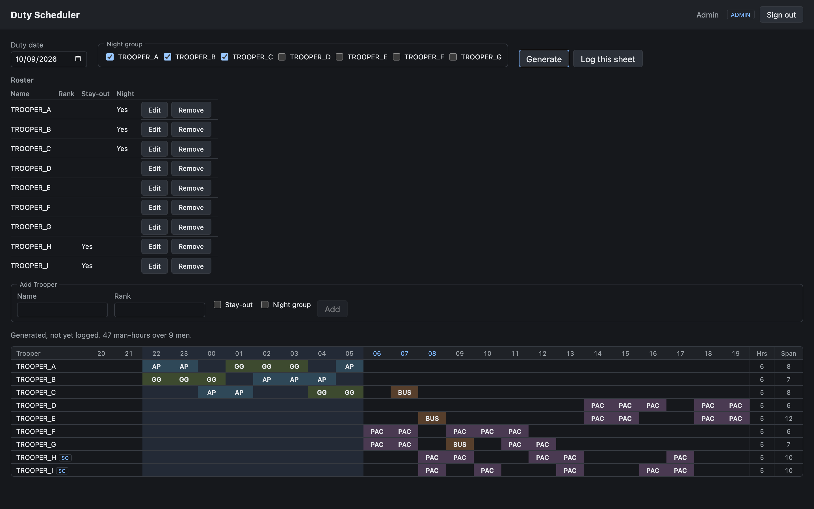

# Duty Scheduler

Generates guard duty schedules for a team under hard constraints, keeps a
record of the sheet that was actually used, and serves both to a browser
client.

- **API**: Spring Boot 4 on Java 21, with PostgreSQL 16 and Flyway
- **Client**: React 19 + TypeScript, built with Vite, in [`web/`](web/)

Both ship together as a single image.



## Features

- **Generate a sheet** for any date from the roster, the leave register and the
  night group. The solver balances hours across the team within the rules.
- **Log the sheet actually used**, including any edits made by hand, and look
  up past sheets by date.
- **Roster** of Troopers, each marked as living in or staying out, with a
  default night group. Troopers can be added, edited and removed. Removing
  someone who stood a logged sheet archives them, so past sheets stay intact.
- **Leave register** that takes absences into account automatically when
  sheets are generated.
- **Two roles**: `ADMIN` manages the roster and leave, and generates and logs
  sheets. `USER` has read-only access.

## How scheduling works

- A **sheet** is named by the evening it starts. It runs 24 hourly slots from
  2000 to 1959 the next morning. Silent hours are 2200–0559.
- Four **posts** are manned: `AP`, `GG`, `PAC`, `BUS`.
- **Hard rules**: at most 3 consecutive hours, at least a 1-hour break, at most
  9 hours per sheet, and stay-outs available 0800–1800 on weekdays.
- **Span is rest-aware.** Duty either side of a gap of 10 hours or more counts
  as two turnouts, not one long one.
- **Crossover is solved.** When manpower is thin, the night group may take
  early day hours. Each possible amount is solved and scored, and the best is
  kept.
- Sheets are **scored** lexicographically: hour spread first, then worst
  excess, then total excess.
- **Leave** covers whole sheets. An absence "until the 12th" removes the 11th's
  sheet entirely and none of the 12th's.
- An independent **validator** checks every rule against the solver's output.

## Prerequisites

| | Version |
| --- | --- |
| Java | 21 |
| Docker | any recent version |
| Node.js | 20.19+ or 22.12+ |

## Running it locally

Use three terminals, starting from the repo root:

```sh
# 1. Database: Postgres 16 on port 5432
docker compose up -d db

# 2. API on http://localhost:8080
./gradlew bootRun

# 3. Client on http://localhost:5173
cd web
npm install
npm run dev
```

Open **http://localhost:5173**. The dev server proxies `/api` and `/actuator`
to the API.

### Development data

`bootRun` uses the `dev` profile, which creates two accounts:

| Username | Password | Role |
| --- | --- | --- |
| `admin` | `admin` | `ADMIN` |
| `trooper_d` | `trooper_d` | `USER` |

To use different passwords, set `DEV_ADMIN_PASSWORD` and
`DEV_TROOPER_PASSWORD`.

It also creates a roster of nine Troopers when the roster is empty:
`TROOPER_A` to `TROOPER_G` live in, with A, B and C as the default night group,
and `TROOPER_H` and `TROOPER_I` stay out.

## Tests

```sh
./gradlew test
```

This runs the unit tests and the integration tests. The integration tests need
Docker running, because they start their own Postgres containers.

Client checks:

```sh
cd web
npm run typecheck
npm run lint
npm run build      # production bundle in web/dist
```

## API

All endpoints are under `/api`. Errors are
[RFC 9457](https://www.rfc-editor.org/rfc/rfc9457) problem documents. A request
that is well formed but cannot be fulfilled returns `422`.

| Method | Path | Access | |
| --- | --- | --- | --- |
| `GET` | `/session` | anyone | Identity and CSRF token |
| `POST` | `/session/login` | anyone | Form-encoded; returns 204 or 401 |
| `POST` | `/session/logout` | signed in | Returns 204 |
| `GET` | `/troopers` | signed in | The roster |
| `POST` | `/troopers` | `ADMIN` | Add a Trooper; 409 when the name is taken |
| `PUT` | `/troopers/{id}` | `ADMIN` | Edit a Trooper's particulars |
| `DELETE` | `/troopers/{id}` | `ADMIN` | Remove a Trooper; archived if they stood a logged sheet |
| `POST` | `/schedules/generate` | `ADMIN` | Generate a sheet; 422 when it cannot be covered |
| `GET` | `/schedules/{date}` | signed in | The logged sheet; 404 when none |
| `PUT` | `/schedules/{date}` | `ADMIN` | Log the sheet actually used |
| `GET` | `/absences` | signed in | The leave register |
| `POST` | `/absences` | `ADMIN` | Record leave |
| `DELETE` | `/absences/{id}` | `ADMIN` | Remove leave |

Write requests must send the CSRF token from `GET /api/session` in an
`X-XSRF-TOKEN` header. The token changes on sign-in and sign-out.

## Project layout

```
src/main/java/com/dutyscheduler/duty/
  domain/        duty days, slots, posts, demand, rules, troopers
  rules/         ScheduleValidator
  solver/        ScheduleSolver, scoring and local improvement
  persistence/   JPA entities, repositories, DutySheetStore
  api/           controllers, security, DTOs
src/main/resources/db/migration/   Flyway migrations
web/                               React client
```
