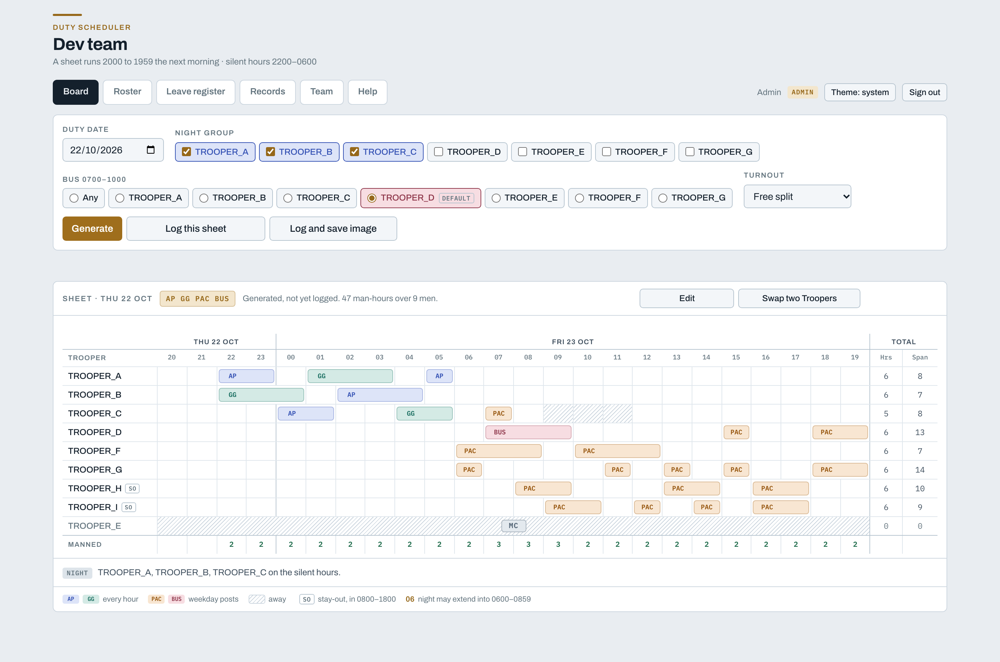
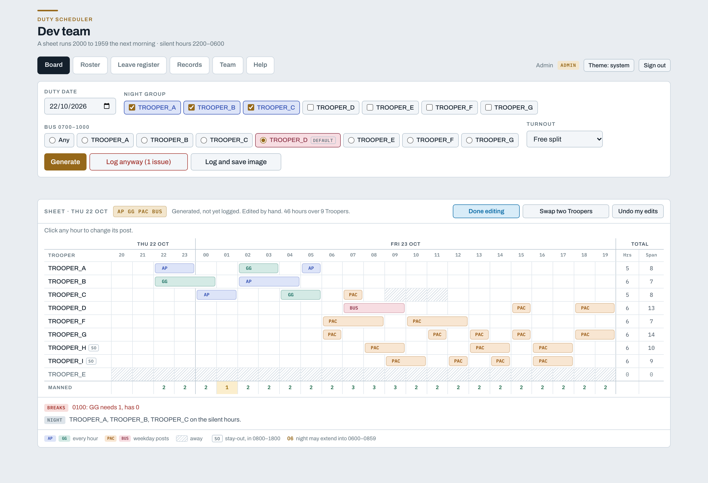
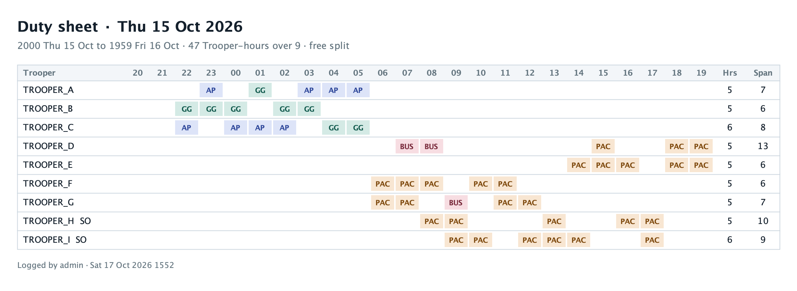
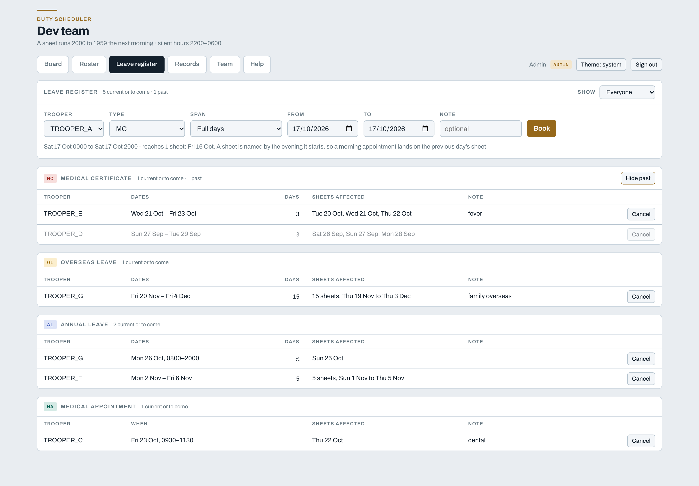
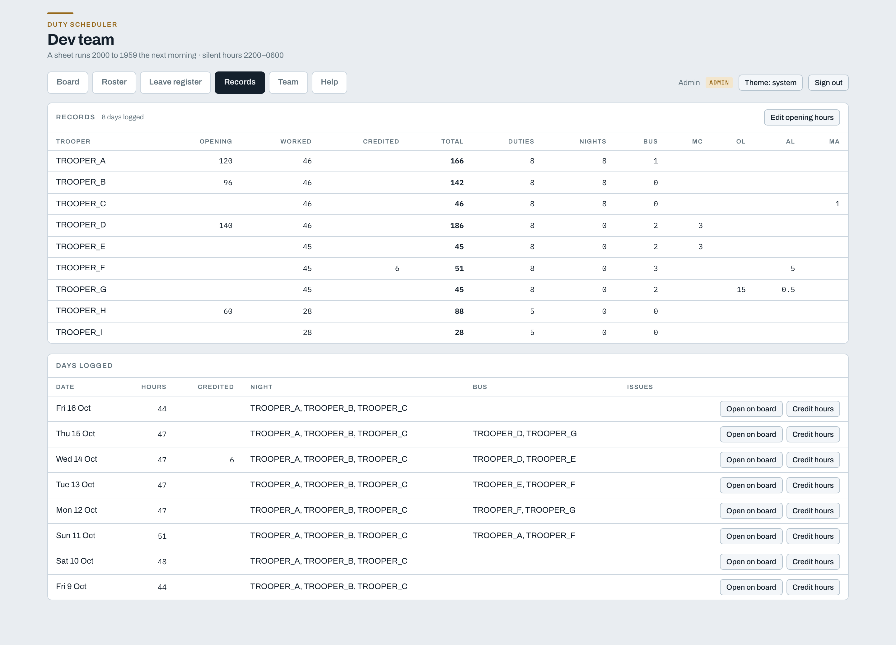
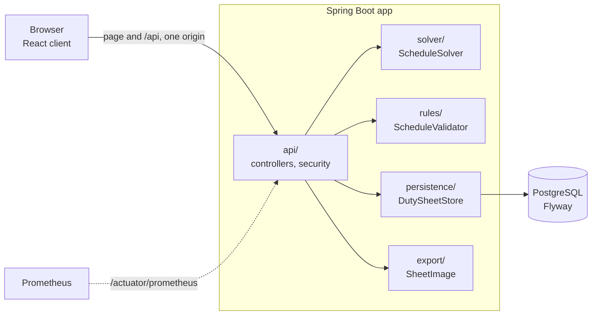

# Duty Scheduler

[](https://github.com/reddevil1313/duty-scheduler/actions/workflows/ci.yml)

Generates guard duty schedules under hard constraints, keeps a record of the
sheet that was actually used, and serves both to a browser client. One server
hosts many teams, and no team sees another's data.

- **API**: Spring Boot 4 on Java 21, with PostgreSQL 16 and Flyway
- **Client**: React 19 + TypeScript, built with Vite, in [`web/`](web/)
- **Shipped** as one image: the API serves the built client from the same
  origin



## Features

- **Generate a sheet** for any date. The solver shares the hours out evenly
  within the rules, with a chosen night group and BUS Trooper, and reuses a
  logged sheet of the same shape and headcount when one fits.
- **Fixed manpower** of 5, 6 or 7 hours each for a short-handed day, with the rest
  left to the MP team.
- **Edit by hand**, checked against the rules as you go. A sheet that breaks
  one can still be logged, after a warning: the log records what was used.
- **Save the sheet as an image**, which logs it in the same step.
- **Leave register** with a table per kind (MC, OL, AL, MA), showing the
  sheets each booking reaches. Roster tickboxes take someone out of a sheet
  without booking anything.
- **Records** of hours, nights, BUS runs and leave per Trooper.
- **Teams and invite links.** The owner makes teams. Admins invite members
  with one-time links and manage the roster and leave. Users can read.
- **Light and dark themes**, and a **Help** tab written for each role.

| | |
| --- | --- |
|  |  |
|  |  |

## Architecture



The solver and the validator share no code, so the validator is an
independent check on every sheet the solver makes. Every team's data is
filtered by team in the persistence layer.

## How scheduling works

- A **sheet** is named by the evening it starts and runs 24 hours, 2000 to
  1959. Silent hours are 2200–0559. Posts are `AP`, `GG`, `PAC` and `BUS`.
- **Hard rules**: at most 3 hours in a row, a break of at least 1 hour, at
  most 9 hours a sheet, and stay-outs only 0800–1800 on weekdays.
- Sheets are **scored** on hour spread first, then excess span, then walks
  between AP and GG.
- An independent **validator** checks every rule against the solver's output.

## Running it locally

Needs Java 21, Docker, and Node.js 20.19+ or 22.12+.

```sh
docker compose up -d db                  # Postgres 16 on 5432
./gradlew bootRun                        # API on 8080
cd web && npm install && npm run dev     # client on http://localhost:5173
```

`bootRun` uses the `dev` profile, which creates a team called "Dev team" with
nine Troopers and these accounts:

| Username | Password | Role |
| --- | --- | --- |
| `owner` | `owner` | `OWNER` |
| `admin` | `admin` | `ADMIN` |
| `trooper_d` | `trooper_d` | `USER` |

## Deploying

```sh
OWNER_USERNAME=... OWNER_PASSWORD=... DATABASE_PASSWORD=... \
  docker compose --profile app up -d --build
```

This builds the image and starts it with Postgres on http://localhost:8080.
For a VM behind Caddy, see [`deploy/`](deploy/). Pushes to `main` deploy
there from CI once the tests pass.
The owner is made on first start from the `OWNER_` variables. Run it behind
HTTPS: the session cookie is HTTPS-only. Metrics are at
`/actuator/prometheus`, for the owner.

## Tests

```sh
./gradlew test                                          # needs Docker
cd web && npm run typecheck && npm run lint && npm run build
```

CI runs both on every push, then builds the image and starts the whole stack.

## API

Endpoints are under `/api`. Errors are
[RFC 9457](https://www.rfc-editor.org/rfc/rfc9457) problem documents, and a
request that is well formed but cannot be fulfilled returns `422`. Writes send
the CSRF token from `GET /api/session` in an `X-XSRF-TOKEN` header.

<details>
<summary>Endpoints</summary>

| Method | Path | Access | |
| --- | --- | --- | --- |
| `GET` | `/session` | anyone | Identity and CSRF token |
| `POST` | `/session/login` | anyone | Form-encoded; 204 or 401 |
| `POST` | `/session/logout` | signed in | 204 |
| `GET` | `/troopers` | team | The roster |
| `POST` `PUT` `DELETE` | `/troopers[/{id}]` | `ADMIN` | Add, edit, remove (archived if on a logged sheet) |
| `POST` | `/schedules/generate` | `ADMIN` | Generate a sheet; 422 when it cannot be covered |
| `GET` | `/schedules/{date}` | team | The logged sheet |
| `POST` | `/schedules/{date}/check` | team | What a sheet breaks; saves nothing |
| `PUT` | `/schedules/{date}` | `ADMIN` | Log the sheet actually used |
| `PUT` | `/schedules/{date}/credits` | `ADMIN` | A logged day's credited hours |
| `POST` `GET` | `/schedules/{date}/image` | `ADMIN` / team | Log and draw, or draw the logged sheet, as PNG |
| `GET` `POST` `DELETE` | `/absences[/{id}]` | team / `ADMIN` | The leave register |
| `POST` | `/absences/preview` | team | The sheets a booking would reach |
| `GET` | `/records` | team | Totals per Trooper, and the days logged |
| `PUT` | `/records/opening` | `ADMIN` | Opening hours |
| `GET` `POST` | `/teams` | `OWNER` | Teams; a new one comes with its first-admin invite |
| `POST` | `/teams/{id}/invites` | `OWNER` | Another invite into a team |
| `GET` `POST` `DELETE` | `/invites[/{id}]` | `ADMIN` | The team's invites |
| `GET` `POST` | `/invites/{token}[/accept]` | anyone | See, or accept, an invite |
| `GET` `PUT` `DELETE` | `/members[/{id}]` | `ADMIN` | The team's accounts |

"Team" is an `ADMIN` or `USER`, who sees only their own team's data.

</details>

## Project layout

```text
src/main/java/com/dutyscheduler/duty/
  domain/        duty days, slots, posts, demand, rules, troopers
  rules/         ScheduleValidator
  solver/        ScheduleSolver, scoring and local improvement
  persistence/   JPA entities, repositories, DutySheetStore
  api/           controllers, security, DTOs
  export/        the sheet image (Java2D)
src/main/resources/db/migration/   Flyway migrations
web/                               React client
Dockerfile, docker-compose.yml     the image, and the stack around it
.github/workflows/ci.yml           tests, client checks, image and stack
```
